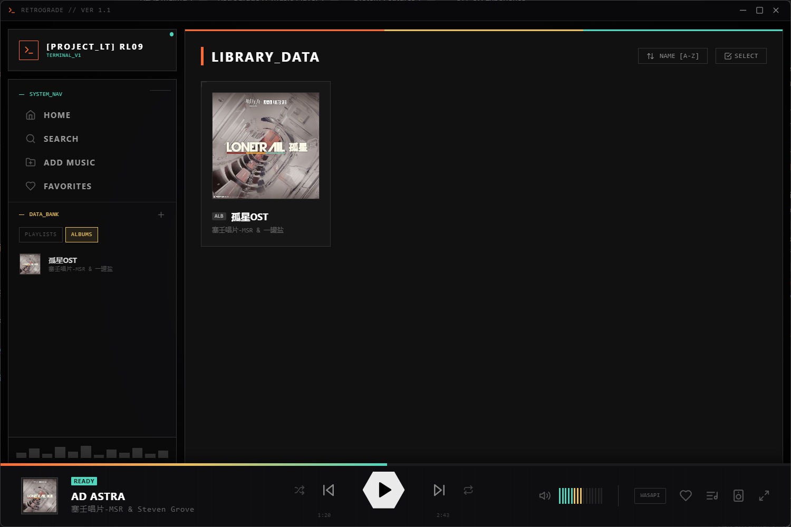
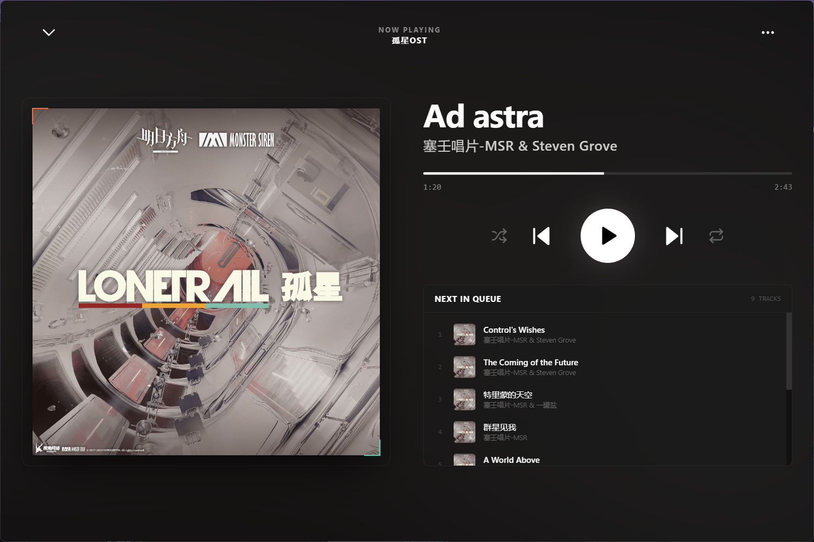

# Retrograde // Music Player
<div align="center">


<p align="center">
  <b>A high-fidelity, local music player built for music lovers with bit-perfect audio, fast library indexing, and a retrofuturistic aesthetic.</b>
</p>

<p align="center">
  <a href="https://github.com/Misaka545/retrograde/releases"><b>⬇️ Download Latest Windows Installer (.exe)</b></a>
</p>

</div>

---

## Interface Preview

| **Library Grid View** | **Full Screen Player** |
|:---:|:---:|
|  |  |

---

## What's New in 2.0

Retrograde 2.0 is a native rewrite in **C# + Avalonia**, replacing the Electron build (1.x). Same interface, same library, a fraction of the footprint:

* **Lighter:** about 0.6% CPU and ~67 MB of memory at idle, with no browser engine underneath.
* **Same data:** reads the 1.x library (`~/.retrograde`) and cover cache as they are, with no rescan, and imports your liked songs and playlists from 1.x on first start.
* **New:** gapless playback, ReplayGain, session restore, a collapsible sidebar, smooth scrolling and a liquid full-screen transition.

The Electron build stays available at the [`v1-electron`](https://github.com/Misaka545/retrograde/tree/v1-electron) tag.

---

## System Features

### Audio Engine
* **Bit-Perfect WASAPI Exclusive Mode:** Playback runs on a background `mpv` process driven over its JSON IPC pipe. Exclusive mode bypasses the Windows mixer for uncompressed, bit-perfect, zero-resample output, and can be switched on and off without stopping the music.
* **Gapless Playback:** The next track is handed to mpv ahead of time, so albums play straight through.
* **ReplayGain:** OFF / TRACK / ALBUM, from the output menu.
* **Hardware Audio Device Routing:** Pick a WASAPI output device from the player bar; the choice is remembered and applied live.
* **Real-time Codec & Stream Inspector:** Codec, bit depth, sample rate and channels for `FLAC`, `WAV`, `ALAC`, `MP3`, `AAC`, `OGG`, `OPUS` and `WMA`.
* **Windows Media Integration:** Media keys and the Windows media card (title, artist, cover, timeline seek).

### Library & Scanner
* **TagLib# Scanner:** Add folders or files, drag and drop them onto the window, or rescan everything with `F5`. Changed files are re-read, new ones added, and missing files removed only after you confirm.
* **Smart Album Grouping:** Multi-disc folders, EPs and compilations with per-track artists stay one album; same-named albums from different artists are kept apart.
* **Cover Art:** Embedded art, or `cover` / `folder` / `front` images next to the tracks, cached as 400px thumbnails plus full-resolution covers.
* **Favorites & Playlists:** Liked Songs, custom playlists with their own covers, and batch album delete.
* **Session Restore:** Queue, current track, position, shuffle and repeat come back on the next start.
* **Self-Healing Data:** A damaged library or playlist file is restored from its backup, and a crashed audio engine restarts on the next Play.

### Interface
* **Retrofuturistic Aesthetics:** High-contrast terminal color scheme with **Teal** (`#4FD6BE`), **Gold** (`#E8C060`) and **Orange** (`#FF6B35`) accents over deep void black.
* **Virtualized Grid & Search:** Smooth with libraries of tens of thousands of tracks.
* **Liquid Full-Screen Player:** Spreads out from the player bar like ink, with a blurred cover backdrop and the upcoming queue.
* **Collapsible Sidebar:** Shrinks to a column of icons and covers (`Ctrl+B`).
* **System Tray & Background Mode:** Keep playing from the tray when the window is closed.

---

## Tech Stack

* **Runtime:** [.NET 10](https://dotnet.microsoft.com/)
* **UI Framework:** [Avalonia 12](https://avaloniaui.net/) with software Skia rendering
* **MVVM:** [CommunityToolkit.Mvvm](https://github.com/CommunityToolkit/dotnet)
* **Audio Engine Backend:** [mpv](https://mpv.io/) via its JSON IPC protocol
* **Metadata Extraction:** [TagLib#](https://github.com/mono/taglib-sharp)
* **Image Processing:** [SkiaSharp](https://github.com/mono/SkiaSharp)
* **Installer:** [NSIS](https://nsis.sourceforge.io/)

---

## Project Architecture

```
retrograde/
├── assets/                       # App icon and images
├── bin/                          # mpv.exe (not in git, see below)
├── docs/                         # Developer notes and screenshots
├── installer/
│   ├── build.ps1                 # Publish + pack the installer
│   └── Retrograde.nsi            # NSIS script
├── src/
│   ├── Retrograde.App/           # Avalonia UI: views, view models, controls, tray, media controls
│   ├── Retrograde.Audio/         # mpv engine (process, IPC pipe, device list)
│   └── Retrograde.Core/          # Library store, scanner, covers, playlists, settings, session
├── tools/                        # Dev checks (dotnet run tools/<file>.cs)
└── Retrograde.slnx
```

---

## Installation & Setup

### Pre-built Windows Release (.exe)
1. Head over to the [GitHub Releases](https://github.com/Misaka545/retrograde/releases) page.
2. Download the latest installer: **`Retrograde Setup 2.0.0.exe`**.
3. Run it. It installs per user (no admin prompt), and `mpv.exe` is bundled.

**Upgrading from 1.x:** uninstall the Electron build first (Windows Settings > Apps > Retrograde); setup will ask you to if it finds it. Your library, playlists and favorites in `%USERPROFILE%\.retrograde` are kept and picked up by 2.0.

---

### Build from Source (Developer Setup)

#### Prerequisites
* **.NET 10 SDK**
* **Windows 10/11**
* **MPV Binary:** a Windows build of `mpv.exe` (from [mpv.io](https://mpv.io/) or [shinchiro's builds](https://sourceforge.net/projects/mpv-player-windows/files/)) in `bin/` at the repository root.
* **NSIS** (only for the installer)

#### Instructions

1. **Clone the Repository**
   ```bash
   git clone https://github.com/Misaka545/retrograde.git
   cd retrograde
   ```

2. **Add mpv**
   ```
   retrograde/bin/mpv.exe
   ```

3. **Run**
   ```bash
   dotnet run --project src/Retrograde.App
   ```

4. **Build the Installer (.exe)**
   ```bash
   powershell -ExecutionPolicy Bypass -File installer/build.ps1
   ```
   *This publishes a trimmed, self-contained Release build and packs it with NSIS into `release/Retrograde Setup <version>.exe`.*

More details (layout, publish options, test tools) are in [docs/DEVELOPMENT.md](docs/DEVELOPMENT.md).

---

## Controls & Shortcuts

| Action | Control / Shortcut |
|---|---|
| **Play / Pause** | `Spacebar` / On-screen Hexagonal Button |
| **Previous / Next Track** | `←` / `→`, `MediaKeys`, on-screen Skip Buttons |
| **Prev Track Rewind** | `Prev` after 3 seconds restarts the current track |
| **Volume Down / Up** | `J` / `K`, or scroll over the volume bars (`1/15` steps) |
| **Mute** | `M` |
| **Shuffle / Repeat** | `Ctrl+S` / `Ctrl+R` |
| **Toggle Fullscreen Player** | `F`, or the expand icon on the player bar |
| **Collapse Sidebar** | `Ctrl+B` |
| **Rescan Library** | `F5` |
| **Context Menu** | Right-click any album or track to like, queue, delete, or add to playlist |
| **Dismiss Overlays** | `Escape` |

---

## License

This project is licensed under the [MIT License](LICENSE.md).

Copyright (c) 2025 Misaka
