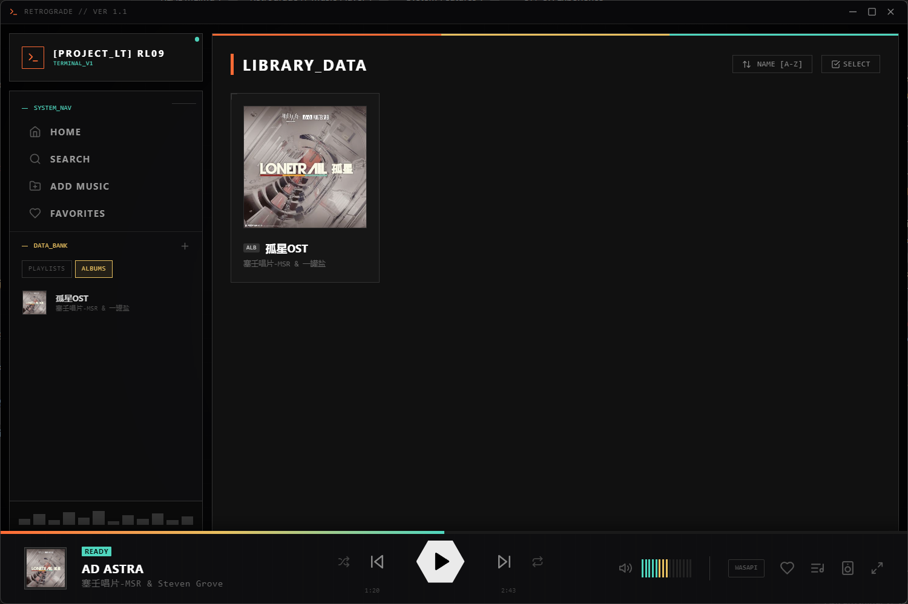

# Retrograde // Music Player
<div align="center">


<p align="center">
  <b>A local music player for Linux built around libmpv and PipeWire, with gapless playback, fast library indexing, and a retrofuturistic aesthetic.</b>
</p>

<p align="center">
  <a href="https://github.com/Okarin2507/rusty-retrograde/releases"><b>⬇️ Download Latest Release (Linux x64)</b></a>
</p>

</div>

---

## Interface Preview

| **Library Grid View** | **Full Screen Player** |
|:---:|:---:|
|  |  |

---

## About this fork

This is a **Linux-only fork** of [Misaka545/retrograde](https://github.com/Misaka545/retrograde). The Windows code was removed; the original Windows build is on the `windows-legacy` branch and in the upstream project.

The default `main` branch is **Retrograde 2.3.0**, rewritten in **Rust + iced 0.14** to replace the earlier C# + Avalonia 2.0–2.2 build (now preserved on the `legacy` branch). It uses the same `~/.retrograde` data folder, so your library, playlists, play counts, and covers carry over automatically.

* **Single native binary:** ~20 MB stripped LTO release binary with no runtime to ship, ~0% idle CPU (~157 MB RSS / 23 threads); `libmpv` and `libasound` are loaded at runtime, and PipeWire is linked.
* **Audio:** mpv runs in-process through the system `libmpv.so.2`; output goes through PipeWire, or straight to an ALSA device for bit-perfect playback with hardware volume.
* **GPU rendering:** wgpu (Vulkan / GL) on the integrated GPU by default, with the tiny-skia CPU renderer as the fallback or a setting.
* **MPRIS:** media keys, `playerctl` and shell widgets (e.g. Noctalia) see title, artist, album, cover, position and volume and can play, pause, skip, seek and change the volume.
* **Tray:** StatusNotifierItem (needs a shell that hosts tray icons; without one, closing the window quits).
* **Wayland:** native Wayland or X11 (display backend setting). Drag and drop of files does not work on native Wayland (use `ADD MUSIC` → `SCAN_FOLDER` / `SCAN_FILES`, or the X11 backend).

---

## What's New in 2.3.0

Retrograde 2.3.0 is a native rewrite in **Rust + iced 0.14**, replacing the C# + Avalonia 2.0–2.2 build (`legacy` branch):

* **Lean native footprint & 0% idle:** single ~20 MB release binary with zero idle animation timers, virtualized album/artist grids and large track lists (`> 80` tracks), and an 8-entry full-resolution cover LRU cache.
* **Direct ALSA + PipeWire audio:** in-process `libmpv` with PipeWire output routing or Direct ALSA bit-perfect playback with hardware volume control, 10-band EQ, ReplayGain, gapless playback, and equal-power crossfade.
* **Full Orbit UI:** custom borderless window with Orbit title bar and edge/corner resize, animated 60px collapsible sidebar rail (`Ctrl+B`), 18-point Catmull-Rom liquid full-screen player, 400×122 mini player with spinning vinyl disc & hover marquee, Orbit Console settings, right-click context menus, `SELECT` mode batch album delete, multi-rule Smart Playlist editor, and Track/Album tag & cover editor via XDG Portals.
* **Same data:** reads existing `~/.retrograde` libraries, playlists, play counts, and covers directly with no rescan.

Prior generations remain available on the `legacy` branch (C# + Avalonia 2.0–2.2 Linux build), the `windows-legacy` branch (original Windows C# build), and the [`v1-electron`](https://github.com/Misaka545/retrograde/tree/v1-electron) tag (Electron 1.x).

---

## System Features

> Note: Queue row drag-reordering is not yet implemented, and OS file drag-and-drop onto the window currently requires X11/XWayland due to a `winit` Wayland limitation (use `ADD MUSIC` → `SCAN_FOLDER` / `SCAN_FILES` on native Wayland).

### Audio Engine
* **In-Process mpv:** Playback runs on libmpv inside the app (no helper process), through PipeWire (ALSA as the fallback).
* **Gapless Playback:** The next track is handed to mpv ahead of time, so albums play straight through.
* **Crossfade:** 2 to 12 seconds of equal-power overlap between tracks; an album played in order stays gapless.
* **10-Band Equalizer:** Octave bands from 32 Hz to 16 kHz, ±12 dB, with presets, adjusted live without a stutter.
* **ReplayGain:** OFF / TRACK / ALBUM, from the output menu.
* **Audio Device Routing:** Pick a PipeWire output device or switch to Direct ALSA bit-perfect output with hardware volume control in the sound popup's OUTPUT tab; the choice is remembered and applied live.
* **Real-time Codec & Stream Inspector:** Codec, bit depth, sample rate and channels for `FLAC`, `WAV`, `ALAC`, `MP3`, `AAC`, `OGG`, `OPUS` and `WMA`.
* **MPRIS Integration:** Media keys, `playerctl` and shell widgets get title, artist, cover and timeline seek.

### Library & Scanner
* **Fast Scanner:** Add folders or files via `ADD MUSIC` (`SCAN_FOLDER` / `SCAN_FILES` using the XDG Portal), drag and drop them onto the window (X11/XWayland), or rescan everything with `F5`. Changed files are re-read, new ones added, and missing files removed only after you confirm.
* **Folder Watching:** New and changed files in the library folders show up by themselves a few seconds after they land (tray menu toggle).
* **Play Counts & History:** Plays are counted after half a track or four minutes; sort albums by *Recently Played* or *Most Played*.
* **Smart Album Grouping:** Multi-disc folders, EPs and compilations with per-track artists stay one album; same-named albums from different artists are kept apart.
* **Cover Art:** Embedded art, or `cover` / `folder` / `front` images next to the tracks, cached as 400px thumbnails plus full-resolution covers.
* **Favorites & Playlists:** Liked Songs, custom playlists with their own covers, and `SELECT` mode batch album delete.
* **Smart Playlists:** Rules over the library (format, bit depth, sample rate, year, length, plays, last played, date added, favorite, title / artist / album text), matched all or any, with an order and a limit. They follow the library and the play counts by themselves; four examples come built in.
* **Artists:** The library grid lists artists as well as albums. An artist page shows the most played tracks and every album; the artist line of an album page and of the player bar lead there.
* **Tag Editor:** Right-click a track for *Edit Tags* (title, artist, album, album artist, year, track and disc number, cover), or edit a whole album's name, artist, year and cover from its page. Written into the files; the library follows at once.
* **Session Restore:** Queue, current track, position, shuffle and repeat come back on the next start.
* **Queue Editing:** *Add to Queue* appends tracks after the current one, *Play Next* inserts them at the front of that line (including in shuffle), and queued tracks can be played or removed from the queue popup.
* **Library Shuffle:** Shuffle mixes the whole library around the playing track; turning it off goes back to the album.
* **Self-Healing Data:** A damaged library or playlist file is restored from its backup, and a crashed audio engine restarts on the next Play.

### Interface
* **Retrofuturistic Aesthetics:** High-contrast terminal color scheme with **Teal** (`#4FD6BE`), **Gold** (`#E8C060`) and **Orange** (`#FF6B35`) accents over deep void black.
* **Virtualized Grid & Search:** Virtualized album/artist grids and large track lists (`> 80` tracks) stay smooth with libraries of tens of thousands of tracks.
* **Liquid Full-Screen Player:** Spreads out from the player bar like ink, with a blurred cover backdrop and the upcoming queue.
* **Synced Lyrics:** Read locally, nothing is fetched online: a `.lrc` file with the same name next to the track first, else the lyrics tag inside the file. With timestamps the line being sung lights up and a click on a line seeks to it; plain text is shown unsynced.
* **Collapsible Sidebar:** Smoothly animates into a 60px rail of icons and covers (`Ctrl+B`).
* **Mini Player:** A 400×122 window with cover art (or a spinning vinyl disc fallback), hover marquee, transport controls, and a Canvas seek strip (`Ctrl+M`, or the button next to full screen). Always-on-top and the remembered position depend on the compositor; Wayland compositors may ignore them.
* **Accent from the Cover:** The seek strip, the playing row and the sung lyric line take the colour of the playing track's cover (tray menu toggle).
* **System Tray & Background Mode:** Keep playing from the tray when the window is closed (StatusNotifierItem).

---

## Tech Stack

* **Language:** [Rust](https://www.rust-lang.org/) (edition 2024)
* **UI Framework:** [iced](https://iced.rs) 0.14, wgpu on the GPU with tiny-skia CPU fallback; Wayland and X11
* **Audio Engine Backend:** [mpv](https://mpv.io/): libmpv in-process; PipeWire bridge sink, direct ALSA output
* **Desktop integration:** MPRIS over D-Bus ([zbus](https://github.com/dbus2/zbus)), StatusNotifierItem tray ([ksni](https://github.com/iovxw/ksni)), XDG portals ([ashpd](https://github.com/bilelmoussaoui/ashpd))
* **Metadata Extraction:** [lofty](https://github.com/Serial-ATA/lofty-rs)
* **Image Processing:** [image](https://github.com/image-rs/image) + [fast_image_resize](https://github.com/Cykooz/fast_image_resize)
* **Packaging:** release tarball + `install.sh`

---

## Project Architecture

```
retrograde/
├── assets/                       # App icon, images, and interface screenshots
├── crates/
│   ├── retrograde-app/           # iced UI and the playback/library coordinator (binary retrograde-rs)
│   ├── retrograde-audio/         # mpv engine (libmpv), direct ALSA output, PipeWire bridge
│   ├── retrograde-core/          # Library store, scanner, covers, playlists, settings, session, lyrics
│   └── retrograde-linux/         # MPRIS, tray, portals, single instance, GPU policy
├── packaging/linux/              # install.sh, package.sh, desktop entry, icon
└── Cargo.toml                    # Cargo workspace
```

The previous C# + Avalonia 2.0–2.2 build is preserved on the `legacy` branch.

---

## Installation & Setup

### Linux (x64)
1. Install the runtime libraries: mpv (`libmpv.so.2`), ALSA (`libasound.so.2`) and PipeWire, e.g. `sudo pacman -S mpv alsa-lib pipewire` or `sudo apt install libmpv2 libasound2 libpipewire-0.3-0`. A tray host (StatusNotifierItem) is needed for background play.
2. Download `retrograde-<version>-linux-x64.tar.gz` from [Releases](https://github.com/Okarin2507/rusty-retrograde/releases), extract it and run:
   ```bash
   ./install.sh
   ```
   This installs the binary as `~/.local/opt/retrograde/Retrograde`, adds a launcher `retrograde` in `~/.local/bin`, an entry in the app drawer and the `retrograde` icon. `./install.sh uninstall` removes it and keeps `~/.retrograde`.

### Build from Source (Developer Setup)

#### Prerequisites
* A recent stable **Rust** toolchain (1.89 or newer).
* `pkg-config`, `clang` (bindgen) and the PipeWire development files (`libpipewire-0.3-dev` / `pipewire`), plus the runtime libraries above.

#### Instructions

1. **Clone the Repository**
   ```bash
   git clone https://github.com/Okarin2507/rusty-retrograde.git
   cd rusty-retrograde
   ```

2. **Run**
   ```bash
   cargo run -p retrograde-app
   ```

3. **Install or package a release build**
   ```bash
   cargo build --release -p retrograde-app   # target/release/retrograde-rs
   packaging/linux/install.sh                # installs that binary for the current user
   packaging/linux/package.sh                # or: dist/retrograde-<version>-linux-x64.tar.gz
   ```

### Environment variables

| Variable | Effect |
|---|---|
| `RETRO_APPDIR=<dir>` | Use another data folder (and run as a separate instance) instead of `~/.retrograde` |
| `RETRO_SHOT=<dir>`, `RETRO_SHOT_STEPS=...` | Dev screenshots of the app's own window, view by view |
| `WGPU_BACKEND`, `WGPU_POWER_PREF`, `ICED_BACKEND` | Override the renderer the GPU setting picks (e.g. `ICED_BACKEND=tiny-skia` for CPU rendering) |

---

## Controls & Shortcuts

| Action | Control / Shortcut |
|---|---|
| **Play / Pause** | `Spacebar` / On-screen Hexagonal Button |
| **Previous / Next Track** | `←` / `→`, media keys (MPRIS, e.g. `playerctl`), on-screen Skip Buttons |
| **Prev Track Rewind** | `Prev` after 3 seconds restarts the current track |
| **Seek -10s / +10s** | `Shift + ←` / `Shift + →` |
| **Volume Down / Up** | `J` / `K` or `↓` / `↑`, or scroll over the volume bars (`1/15` steps) |
| **Mute** | `M` |
| **Shuffle / Repeat** | `Ctrl+S` / `Ctrl+R` |
| **Toggle Fullscreen Player** | `F`, or the expand icon on the player bar |
| **Focus Library Search** | `/` or `Ctrl+F` |
| **Collapse Sidebar** | `Ctrl+B` |
| **Mini Player** | `Ctrl+M`, or the mini player icon on the player bar |
| **Keyboard Shortcuts** | `?` |
| **Rescan Library** | `F5` |
| **Context Menu** | Right-click any album or track to like, queue, edit tags, delete, or add to playlist |
| **Dismiss Overlays** | `Escape` |

---

## License

This project is licensed under the [MIT License](LICENSE.md).

Copyright (c) 2025 Misaka

Linux fork: Okarin2507
